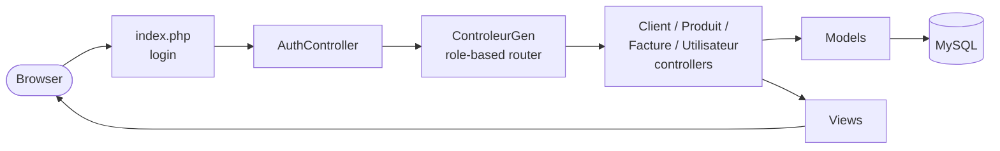

# Sales & Invoicing Management App – PHP MVC


A web application for managing **clients, products, invoices and users**, with **role-based access control**. It's written in plain PHP (no framework) on a hand-built **Model–View–Controller** structure, with MySQL through PDO.

---

## Features

- **Login and sessions**, with three roles that each see only their own part of the app:

| Role | Can manage |
|---|---|
| **Administrator** (`admin`) | Users, clients, products, invoices – everything |
| **Senior agent** (`agentSup`) | Products and stock |
| **Agent** (`agent`) | Invoices |

- Full **CRUD** (create, read, update, delete) on every entity
- **Invoices with several product lines** (an invoice ↔ products many-to-many table, with quantities)
- **Zero-setup database**: on first launch, the app creates the `BOUCETLA` database and its tables, then fills them with sample clients, products and invoices
- **PDO prepared statements** for queries, and input escaping with `htmlspecialchars`

## Architecture



```
├── index.php                  # Entry point: login
├── Config/Database.php        # PDO connection + automatic schema creation and seed data
└── application/
    ├── Controleurs/           # Controllers: Auth, Gen (router), Client, Produit, Facture, Utilisateur
    ├── Models/                # Data access for each entity
    ├── Vues/                  # PHP views (pages and forms)
    └── Css/                   # Stylesheets
```

### Database schema

`utilisateurs` (users) · `client` · `produit` (product) · `facture` (invoice → client) · `produitFacture` (invoice line: invoice ↔ product, quantity), with foreign keys and cascading updates and deletes.

## How to run

1. Install a local PHP + MySQL stack (XAMPP, WAMP or MAMP).
2. Copy the project into the web root **as a folder named `boucetlaMohammedAnes`** (the internal redirects use this path), e.g. `htdocs/boucetlaMohammedAnes`.
3. Start Apache and MySQL. The app connects as `root` with an empty password; change this in `Config/Database.php` if needed.
4. Open `http://localhost/boucetlaMohammedAnes/` and log in with one of the demo accounts:

| Role | Username | Password |
|---|---|---|
| Administrator | `admin` | `password1` |
| Senior agent | `agentSup` | `password2` |
| Agent | `agent` | `password3` |

## Possible improvements

This was a coursework project focused on MVC and CRUD. A production version would add:
- Password hashing with `password_hash()` / `password_verify()` instead of plain-text storage
- Login submitted by `POST` instead of `GET`, plus CSRF tokens on forms
- Configuration from environment variables and a front controller with routing instead of hard-coded paths

## Author

**Mohammed Anes Boucetla** – Web development coursework, ENSTTIC · [github.com/moxaness](https://github.com/moxaness)
